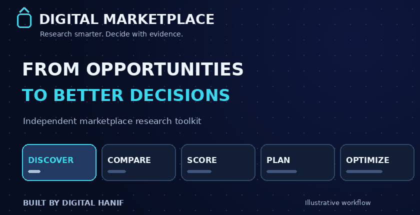
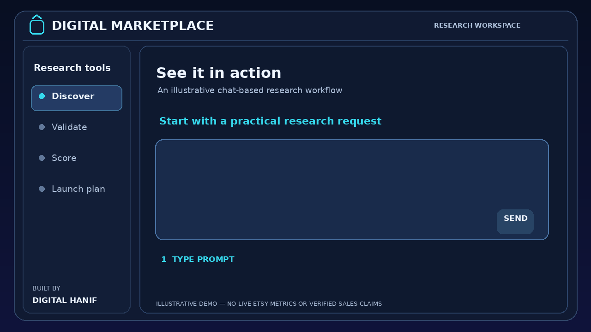

# Digital Marketplace

<p align="center">
  
</p>

<p align="center">
  <strong>Independent marketplace research. Evidence before assumptions.</strong>
</p>

<p align="center"> </p>

<p align="center">
  <a href="#see-it-in-action">See it in action</a> ·
  <a href="#features">Capabilities</a> ·
  <a href="#installation-on-windows--codex-desktop">Install</a> ·
  <a href="#legal-disclaimer">Legal notice</a>
</p>

**Independent AI research toolkit for sellers on Etsy**

**Etsy Market Research • Product Opportunity Intelligence • Codex Skill**

**Created and maintained by Muhammad Hanif Haroon** | **Digital Hanif** | Version 1.0.0

Digital Marketplace is my structured Etsy research and decision-support system. It helps evaluate digital and eligible physical product opportunities for the United States market through repeatable research, competitor analysis, keyword clustering, profitability modeling, compliance screening, and evidence-based launch planning.

> **Independent third-party research tool — not affiliated with Etsy.** Digital Marketplace is not an official Etsy product and is not endorsed, sponsored or represented by Etsy, Inc. It is intended for educational and research-based decision support, not guaranteed earnings or professional advice. All business decisions and potential profits or losses are the user's responsibility. See [Legal Disclaimer](DISCLAIMER.md) and [LICENSE](LICENSE).

> **Status:** Working research toolkit and Codex skill. Live Etsy API access is not configured. Public marketplace signals and third-party estimates must never be presented as confirmed sales data.

## Contents

1. [Features](#features)
2. [Requirements](#requirements)
3. [See it in action](#see-it-in-action)
4. [Installation on Windows / Codex Desktop](#installation-on-windows--codex-desktop)
5. [Getting started](#getting-started)
6. [Usage tutorials](#usage-tutorials)
7. [Scoring and profit calculations](#scoring-and-profit-calculations)
8. [Project structure](#project-structure)
9. [Tests and verification](#tests-and-verification)
10. [Troubleshooting](#troubleshooting)
11. [Research integrity and limitations](#research-integrity-and-limitations)
12. [Maintenance and ownership](#maintenance-and-ownership)
13. [Legal disclaimer](#legal-disclaimer)

## Brand and marketplace focus

**Digital Marketplace** is the independent product brand. This toolkit currently focuses on research for sellers using the Etsy marketplace. The word *Etsy* is used descriptively to identify that third-party marketplace; it is not part of the product's brand name. This is not an Etsy product, and no association or authorization is implied.

**Public repository:** [digitalhanif/digital-marketplace-public](https://github.com/digitalhanif/digital-marketplace-public).

## See it in action

<p align="center">
  
</p>

**Demo flow:** Type an actual Digital Marketplace research request → send → see the assistant's illustrative first response and shortlist. The 1280 × 720 animation runs for approximately 15 seconds.

This is an **illustrative interface animation**, not a recording of a completed ChatGPT session, a bundled app dashboard, or actual Etsy research output. The depicted ideas are examples only; no sales, search-volume or demand figures are claimed. A real run depends on the AI assistant and research sources available in your environment.

**Try this prompt in your assistant:**

```text
Use Digital Marketplace to research five digital product ideas for US Etsy buyers.
Compare attributable marketplace signals, competitor positioning, keyword
opportunities, estimated costs and intellectual-property risks. Include
source URLs and observation dates. Mark unavailable metrics as unknown.
Give me a ranked shortlist and a practical 14-day validation experiment.
Do not invent sales, search-volume or demand figures.
```

## Features

| Capability | What it does |
| --- | --- |
| Niche discovery | Organizes candidate Etsy product niches by buyer, season, and market |
| Trend research | Distinguishes evergreen, seasonal, and emerging opportunities |
| Competitor intelligence | Reviews observable listing prices, formats, differentiation, and customer signals |
| Keyword research | Groups primary and long-tail buyer-intent keywords; does not invent search volumes |
| Opportunity scoring | Applies a transparent seven-factor weighted scoring model |
| Profit estimation | Models per-order costs and margins using explicit assumptions |
| Product development | Produces original product briefs, format specifications, and QA requirements |
| Listing optimization | Drafts title, tags, description, and media checklist |
| Compliance checks | Flags Etsy eligibility, intellectual property, and disclosure concerns |
| Growth review | Structures analysis of authorized shop metrics and experiments |

The system is designed for digital products first, with support for Etsy-eligible physical products as the business expands.

**Artwork:** The animated walkthroughs above are original, illustrative marketing visuals. This toolkit includes research instructions and local utilities, not a graphical analytics dashboard.

## Requirements

- Codex-compatible client with skills support.
- Windows and PowerShell for the included installer.
- Python 3.10+ for scripts and local tests.
- Access to current, permitted research sources; no included Etsy API key.

## Installation on Windows / Codex Desktop

### Method A: Automated installation

**Step 1 — Clone the repository**

Open PowerShell in the directory where the project should be stored:

```powershell
git clone https://github.com/digitalhanif/digital-marketplace-public.git digital-marketplace
cd digital-marketplace
```

You may alternatively extract the verified release archive. Never place tokens in scripts.

**Step 2 — Review and run the installer**

The repository includes `install-windows.ps1`. Review it before running it. From the repository root:

```powershell
powershell -NoProfile -ExecutionPolicy Bypass -File .\install-windows.ps1
```

The installer copies the skill to:

```text
%USERPROFILE%\.agents\skills\digital-marketplace\
```

If an existing Digital Marketplace installation is found, the installer creates a timestamped backup before replacing it. Check your Codex skills folder for any duplicate older installations and manually archive only those you have verified are no longer needed.

**Step 3 — Verify the files**

```powershell
Test-Path "$HOME\.agents\skills\digital-marketplace\SKILL.md"
```

Expected result: `True`.

**Step 4 — Check the installed skill metadata**

From the repository root, use the included read-only validator:

```powershell
.\verify-codex-install.ps1
```

It confirms required installed files and the skill identifier, but does **not** prove that Codex has discovered or executed the skill.

**Step 5 — Restart Codex Desktop**

Open or restart Codex Desktop so it can discover the skill. In a new chat, try: `Use Digital Marketplace to research one US digital product idea. Cite sources, and label unknown metrics.` Confirm it reads the installed skill and follows its workflows. If not, check your Codex version's skill-directory settings. GitHub's Windows installation tests do not authenticate or operate your Codex Desktop application.

### Method B: Manual installation

1. Clone or download the repository using your GitHub account.
2. Copy the **contents of the repository root** to `%USERPROFILE%\.agents\skills\digital-marketplace\`.
3. Confirm `SKILL.md` is directly inside the destination directory.
4. Restart Codex Desktop and run the first-use prompt below.

## Getting started

In Codex Desktop, start with this request:

```text
Use Digital Marketplace to identify five promising digital
product niches for US Etsy buyers. Compare observable demand signals,
competitor positioning, keyword intent, estimated margins, differentiation,
production feasibility, and Etsy compliance. Cite sources and dates, score
the candidates, and recommend a practical 14-day validation plan.
Do not invent sales figures or keyword volumes.
```

**Expected deliverables:** a ranked opportunity table, evidence and source notes, scoring breakdown, risks, and a recommended validation experiment. Results depend on the live sources actually available to Codex.

## Usage tutorials

### Tutorial 1 — Discover a profitable-looking niche

**Goal:** Find opportunities before committing to production.

```text
Run the discover workflow for US Etsy digital products. My available tools
are Canva, Photoshop, Illustrator, and spreadsheets. My starting budget
is USD 100–300. Consider both evergreen and seasonal products. Identify
20 candidates, then shortlist the five strongest based on verifiable signals.
For every claim, record the source and research date.
```

Review the shortlist, then request deeper validation. A high research score is **not** proof of sales.

### Tutorial 2 — Validate one product idea

```text
Run the validate workflow for editable birthday invitation templates
targeting US buyers. Analyze comparable Etsy listings, differentiation,
keyword clusters, expected production time, pricing assumptions, and
intellectual-property risks. Show all seven opportunity-scoring factors,
confidence levels, and a TEST / WATCH / SKIP recommendation.
```

Use the findings to decide whether a small product prototype is worthwhile.

### Tutorial 3 — Prepare a product and listing

```text
Run the create-product workflow for the selected validated niche.
Draft an original product brief, deliverable file formats, quality-control
checklist, customer instructions, and a truthful mockup plan.
Then run the launch workflow to prepare an Etsy title, 13 relevant tags,
description, pricing test, and launch checklist.
Do not publish or purchase anything without my approval.
```

### Tutorial 4 — Improve an existing listing

```text
Run the optimize workflow using my authorized Etsy shop metrics.
Compare impressions, visits, favorites, orders, conversion rate, costs,
and customer feedback. Identify the most likely bottleneck and propose
one measurable experiment at a time. Separate observations from hypotheses.
```

Only use shop analytics you are authorized to access or have supplied.

### Tutorial 5 — Evaluate physical-product expansion

```text
Evaluate original personalized jewelry opportunities for US Etsy buyers.
Check current Etsy Creativity Standards and seller eligibility, supplier
and production-partner requirements, shipping economics, lead times,
returns, and intellectual-property risks. Do not assume ordinary wholesale
resale is permitted. Produce a sourcing and compliance checklist.
```

## Scoring and profit calculations

### Opportunity score

Seven factors receive ratings from **0 to 10**. Weighted scores are reported on a **0–100** scale:

| Factor | Weight |
| --- | ---: |
| Buyer demand | 25% |
| Competition opportunity | 20% |
| Profit potential | 20% |
| Trend sustainability | 10% |
| Differentiation | 10% |
| Production feasibility | 10% |
| Strategic fit | 5% |
| **Total** | **100%** |

The default guidance is: 80–100 prioritize validation; 65–79 test; 50–64 watch; below 50 skip. Compliance failures override the numeric score. Evidence confidence is reported separately.

Run the example:

```powershell
python scripts/score_opportunities.py tests/sample-opportunities.json
```

The sample JSON is **illustrative**, not verified Etsy market research.

### Profit estimates

The `scripts/calculate_profit.py` module supports configurable product cost, shipping, packaging, listing fee, transaction percentage, payment fees, advertising, refund reserve, and other costs. Verify current Etsy fees for your shop location and transaction before using a forecast.

Example:

```powershell
python -c "from scripts.calculate_profit import profit; print(profit(price=10, production=1, ads=0.5))"
```

Do not treat illustrative default fee assumptions as current official Etsy rates.

## Project structure

```text
digital-marketplace/       # installed skill folder and recommended local clone name
├── SKILL.md                  # Codex skill definition
├── AGENTS.md                 # Operating instructions
├── README.md                 # Project guide
├── install-windows.ps1       # Windows installation helper
├── agents/                   # Specialist research instructions
├── workflows/                # Discover, validate, create, launch, optimize
├── config/                   # Business profile, scoring, source guidance
├── policies/                 # Evidence, compliance, quality assurance
├── scripts/                  # Scoring, profitability, normalization, reports
├── templates/                # Research and launch templates
├── tests/                    # Python scoring and animation smoke tests
└── assets/                   # Original illustrative demo animations
```

## Tests and verification

From the project root, run:

```powershell
python -m unittest discover -s tests -v
python scripts/score_opportunities.py tests/sample-opportunities.json
```

GitHub Actions is configured to run Python tests on pushes and pull requests. Inspect the repository's **Actions** tab for the actual CI result; a committed workflow alone does not prove the tests passed.

## Troubleshooting

**Git is not recognized:** Install Git for Windows, reopen PowerShell, and run `git --version`.

**Repository cannot be cloned:** Check the URL, network access, and whether the release has been made public. Private development repositories require authorized access.

**PowerShell blocks scripts:** Review the installer and invoke it using the command under Method A. Do not change system-wide execution policy unnecessarily.

**Codex does not recognize the skill:** Confirm the installed `SKILL.md` path, restart Codex, and verify your Codex build's supported skills location.

**Python is not recognized:** Install a supported Python version and check `python --version`.

**Research output lacks verified sales or keyword volumes:** That is expected unless a permitted, trustworthy data source supplies them. Missing figures must remain unknown.

**Scoring fails:** Check that each opportunity has all seven factor ratings, each between 0 and 10.

## Research integrity and limitations

This toolkit supports decisions; it does not guarantee profitable products or daily sales. Public Etsy listing signals, third-party estimates, and directly observed seller analytics are different evidence categories and must remain clearly labeled.

Research must comply with applicable Etsy policies and data-access terms. Do not scrape restricted data, bypass access controls, reproduce protected designs, or misrepresent product eligibility. Validate current rules before selling digital or physical products.

## Maintenance and ownership

**Created and maintained by Muhammad Hanif Haroon**
**Brand:** Digital Hanif
**Release channel:** Independently approved clean public repository

This is source-available proprietary software, not open source. The license permits personal/internal evaluation and local use, but prohibits redistribution or resale without written permission. Review `LICENSE` before using the software. See `SECURITY.md` before publishing.

## Legal disclaimer

**Digital Marketplace is independently developed by Muhammad Hanif Haroon (Digital Hanif). It is not an official Etsy tool; neither the developer nor the publisher is affiliated with, authorized by, endorsed by, or a representative of Etsy, Inc.** Etsy is a trademark of Etsy, Inc.

This product is for **educational, research and analytical decision-support purposes**. Estimates, research insights, sample scores and forecasts are not guaranteed to be accurate or profitable. **No guarantee is made of sales, earnings, revenue or profit.** Users must independently verify information and accept business risks, including financial loss. To the extent permitted by law, the developer and publisher do not accept liability for losses resulting from use of or reliance on this toolkit. For full terms, read [DISCLAIMER.md](DISCLAIMER.md) and [LICENSE](LICENSE).
